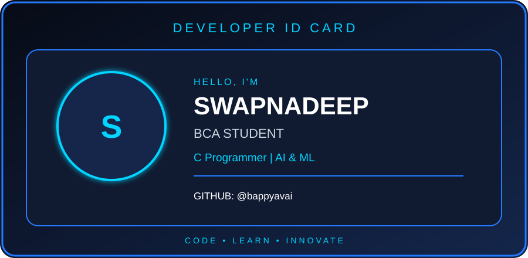

<!-- 1. HERO BANNER -->

  

<!-- 2. ELECTRIC BLUE ANIMATED TYPING -->

  

---

### 🧑‍💻 About Me

> *"Code • Learn • Innovate — Let's grow together!"*

- 👋 Hi! I'm **Swapnadeep**, also known as **Deep vai**.
- 🎓 I'm a **BCA Student** from **India**, passionate about **Coding**, **AI**, and **Machine Learning**.
- 💻 Currently sharpening my skills in **C Programming**, **Python**, and **Web Development**.
- 🚀 I love to explore new technologies and build something meaningful.

 

---

### 🪪 Live Developer ID Card

  

---

### ⚙️ Skills & Tech Stack

  

  
  
  
  
  
  
  
  
  

---

### 🚀 Featured Projects

| Project | Domain | Description |
| :--- | :--- | :--- |
| 🚆 **Rail Track Crack Detection** | `Computer Vision` •
