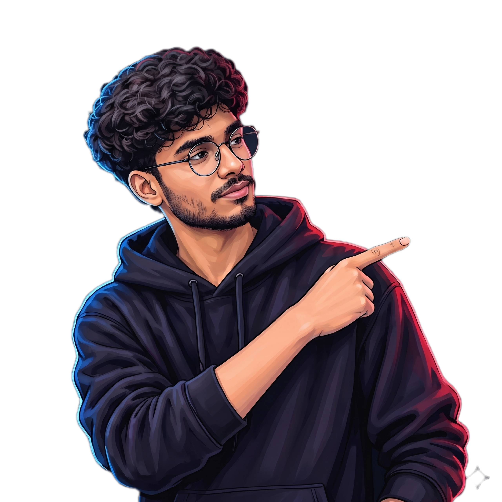

<!-- 1. HERO BANNER -->

  

<!-- 2. ELECTRIC BLUE ANIMATED TYPING -->

  

---

<h2 align="center">✨ ABOUT ME ✨</h2>

  

<table>
<tr>
<td width="65%">

<h3>🚀 Who Am I?</h3>

👋 Hi! I'm <b>Swapnadeep (Bappya)</b>.

🎓 BCA Student from India.

💻 Interested in C Programming & Python.

🤖 Exploring Artificial Intelligence & Machine Learning.

🌐 Learning Web Development.

🚀 Love creating innovative projects.

🤝 Open to Collaboration.

<h3>🎯 My Mission</h3>

To learn, build and create something meaningful!

</td>

<td width="35%" align="center">

<h3>💜 Swapnadeep</h3>

<b>Dream Big • Code Better</b>

</td>
</tr>
</table>

<h3 align="center">⚡ MY MINDSET</h3>

---

### 🪪 Live Developer ID Card

  

---

<h2 align="center">⚡ Skills & Tech Stack</h2>

  <i>Technologies I'm learning and working with</i>

<h3 align="center">💻 Programming Languages</h3>

  

<h3 align="center">🌐 Web Development</h3>

  

<h3 align="center">🤖 AI & Machine Learning</h3>

  
  

<h3 align="center">🛠️ Tools & Platforms</h3>

  

<h3 align="center">📚 Currently Learning</h3>

  
  
  

### 🚀 Featured Projects

| Project | Domain | Description |
| :--- | :--- | :--- |
| 🚆 **Rail Track Crack Detection** | `Computer Vision` • `Python` | Automated system to detect railway track cracks using AI & image processing. |
| 🎓 **Student Result App** | `C Programming` | Console-based student grade and result management application built in C. |
| 🌐 **Portfolio Website** | `HTML` • `CSS` • `JS` | Modern responsive personal developer portfolio showcasing skills and work. |

---

<h3>🔗 Connect With Me</h3>

  <table>
    <tr>
      <td align="center" valign="middle">
        
      </td>
      <td align="left" valign="middle">
        
          
        
          
        
      </td>
    </tr>
  </table>

  

